<div align="center">

# Sift

**A retrieval-augmented generation engine built from first principles, then measured honestly.**

Sift combines BM25, a from-scratch HNSW index, rank fusion, cross-encoder reranking and Claude's
native citations, so every sentence of an answer points at an exact character span of its source.


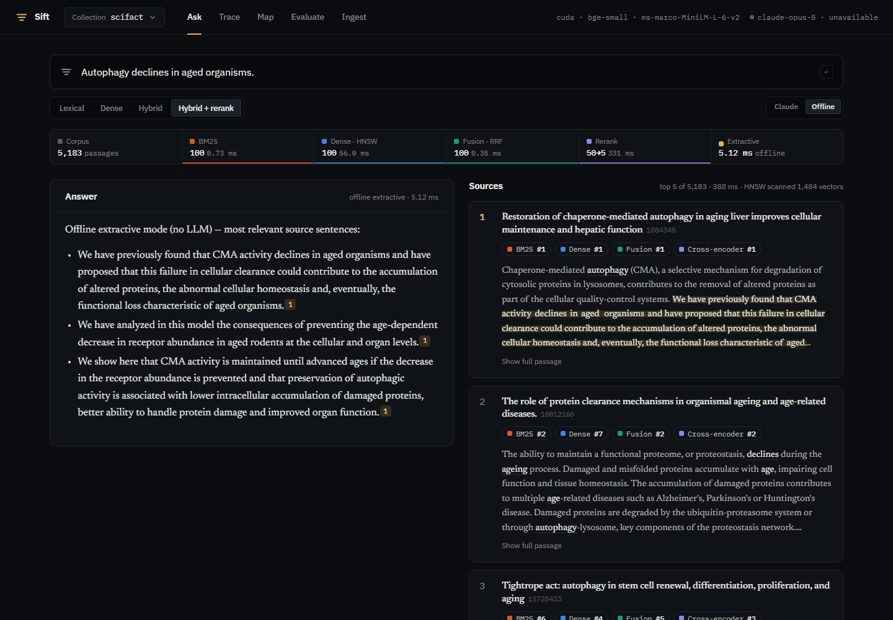

</div>

---

## Highlights

- BM25 with my own Porter stemmer scores 0.677 nDCG@10 on SciFact and 0.321 on NFCorpus, against
  Anserini's published 0.679 and 0.322. The stemmer agrees with NLTK's reference on all 40,079 corpus
  words.
- Hybrid retrieval beats both of its inputs: 0.736 on SciFact (convex fusion, weight tuned on train)
  vs 0.677 for BM25 and 0.713 for dense, and 0.366 on NFCorpus vs 0.321 and 0.343.
- The most interesting result: an off-the-shelf MS MARCO cross-encoder makes a strong hybrid first
  stage *worse* on both datasets, and the deeper it reranks the worse it gets. Blending its score with
  the first-stage score (weight tuned on train) turns that loss into the best NFCorpus result.
- HNSW written from scratch in numba. On 79,036 real sentence embeddings it's 10.1× faster than exact
  search at recall@10 ≥ 0.95 (1,266 vs 125 queries/s, single-threaded) and touches 2.1% of the
  vectors per query. The benchmark also shows where exact search still wins (around 5k vectors).
- Citations come out exact by construction. Every chunk keeps its character offsets and Claude's
  citations come back as offsets into those chunks, so composing the two gives the source span with no
  string matching.
- End-to-end claim verification on SciFact, reporting label accuracy, macro-F1, citation precision
  and sentence-level rationale precision across four evidence conditions.
- The UI shows its work: streaming answers, citation chips that highlight source spans, a per-query
  trace (latency waterfall, rank-flow threads, score distributions), an embedding map of the corpus,
  an evaluation dashboard, and side-by-side chunking comparisons.

The claim-verification results below come from an offline NLI verifier, so the whole benchmark runs
without an API key. The Claude-backed evaluation uses the same harness, is tested against the SDK
through a mock transport, and runs with `python -m sift.eval claims --verifier claude` (responses are
cached on disk).

---

## The pipeline

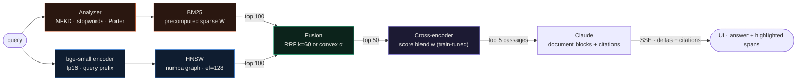

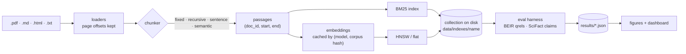

---

## Results

All numbers are from `results/*.json`, produced by the commands in [Reproduce](#reproduce). Test
splits are never used for tuning.

### Retrieval quality (BEIR, nDCG@10, test)

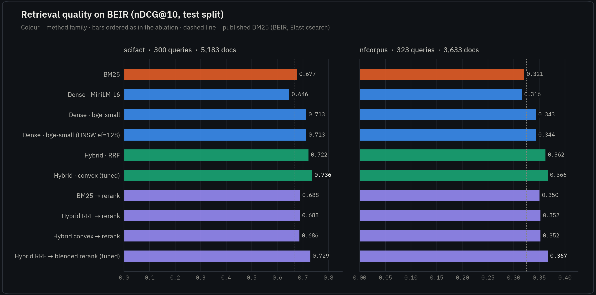

| Method | SciFact nDCG@10 | SciFact R@100 | NFCorpus nDCG@10 | NFCorpus R@100 |
|---|---:|---:|---:|---:|
| BM25 (k1=0.9, b=0.4) | 0.677 | 0.929 | 0.321 | 0.246 |
| Dense · all-MiniLM-L6-v2 | 0.646 | 0.925 | 0.316 | 0.312 |
| Dense · bge-small-en-v1.5 | 0.713 | 0.942 | 0.343 | 0.311 |
| Dense · bge-small, **my HNSW** (ef=128) | 0.713 | 0.945 | 0.343 | 0.313 |
| Hybrid · RRF (k=60) | 0.722 | **0.968** | 0.362 | 0.311 |
| Hybrid · convex (α tuned on train) | **0.736** | 0.967 | 0.360 | **0.314** |
| BM25 → cross-encoder | 0.688 | 0.929 | 0.350 | 0.246 |
| Hybrid RRF → cross-encoder | 0.688 | 0.968 | 0.352 | 0.311 |
| Hybrid RRF → cross-encoder, **blended** (w tuned on train) | 0.729 | 0.968 | **0.366** | 0.311 |

Reference points:
- Published BM25: SciFact 0.665 (BEIR, Elasticsearch) and 0.679 (Anserini); NFCorpus 0.325 and 0.322.
- Published BM25 + MiniLM cross-encoder (BEIR): SciFact 0.688, NFCorpus 0.350. My implementation
  matches both.
- HNSW loses nothing measurable against exact search at ef=128.

### The reranker finding

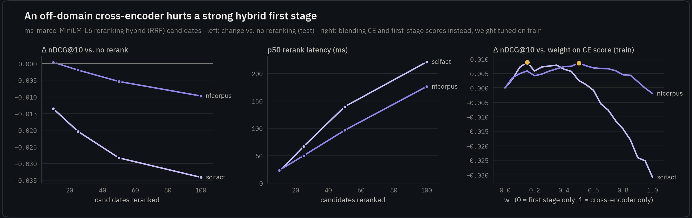

Reranking a hybrid first stage with `ms-marco-MiniLM-L-6-v2` costs **−0.029 nDCG@10 on SciFact and
−0.005 on NFCorpus** at depth 50, and the loss grows with depth. Blending
`w·minmax(CE) + (1−w)·minmax(first stage)` instead of replacing the first-stage order changes the
picture:

| | w (tuned on train) | hybrid RRF | rerank (pure CE, @50) | **blended @50** |
|---|---:|---:|---:|---:|
| SciFact | 0.15 | 0.722 | 0.694 | **0.729** |
| NFCorpus | 0.50 | 0.362 | 0.356 | **0.366** |

The service uses the blended reranker, with per-collection weights loaded from these results.

### Fusion weight, tuned on train

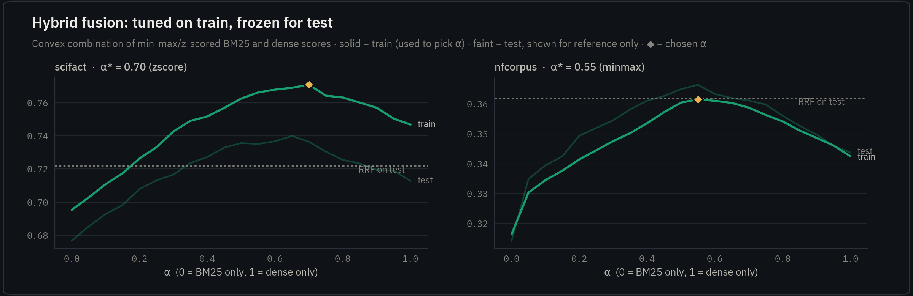

### HNSW vs exact search

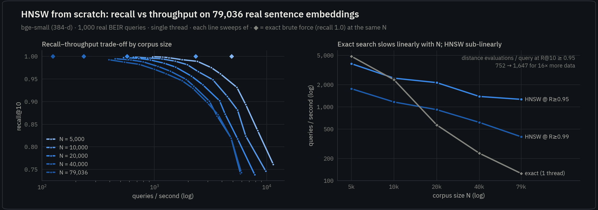

| N vectors | build (s) | exact QPS (1 thread) | HNSW QPS @ R@10 ≥ 0.95 | ef | vectors scanned / query |
|---:|---:|---:|---:|---:|---:|
| 5,000 | 3.5 | **4,867** | 3,859 | 48 | 752 (15%) |
| 10,000 | 8.0 | 2,333 | **2,455** | 64 | 1,033 (10%) |
| 20,000 | 20.9 | 569 | **2,137** | 64 | 1,109 (5.5%) |
| 40,000 | 52.4 | 235 | **1,387** | 96 | 1,610 (4.0%) |
| 79,036 | 121.7 | 125 | **1,266** | 96 | 1,647 (2.1%) |

Setup: 384-d bge-small embeddings of every sentence in SciFact + NFCorpus; 1,000 real BEIR queries;
M=16, efConstruction=200.
- At 79k, recall@10 ≥ 0.99 needs ef=384 (393 QPS).
- Graph degree trades build time for beam width: M=8/16/32 reach recall 0.95 at ef=192/96/64 and build
  in 73/122/156 s.
- Exact search with multi-threaded BLAS reaches 204 QPS at 79k, so HNSW is still 6.2× faster.

### Where a query's time goes

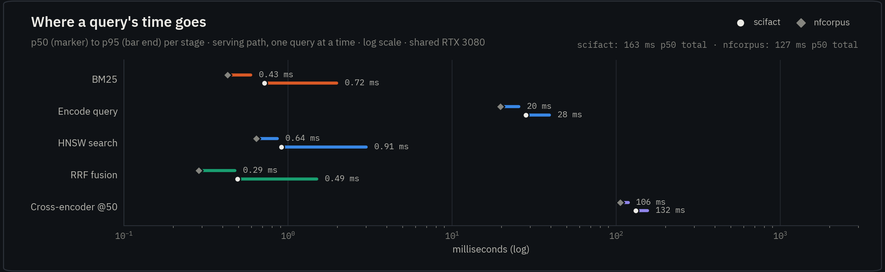

Retrieval without reranking costs **22.6 ms p50** (SciFact) and **33.3 ms** (NFCorpus), dominated by
query encoding. BM25, HNSW and fusion each take under 1 ms. The cross-encoder over 50 candidates adds
170–230 ms. These timings were taken on an RTX 3080 that was concurrently running another training
job, so treat them as upper bounds.

### End-to-end claim verification (SciFact dev)

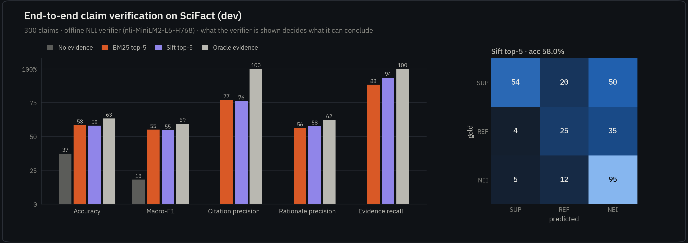

The task: given a SciFact claim, retrieve abstracts, decide SUPPORTED / REFUTED / NOT ENOUGH INFO, and
cite the sentences behind the verdict. The reader is the offline NLI verifier
(`nli-MiniLM2-L6-H768`, relevance-gated). Its thresholds are tuned on the 809 train claims and it is
evaluated on all 300 dev claims.

| Evidence shown to the verifier | evidence recall@5 | accuracy | macro-F1 | citation precision | rationale precision |
|---|---:|---:|---:|---:|---:|
| none (always NEI) | n/a | 37.3% | 0.181 | n/a | n/a |
| BM25 top-5 | 0.883 | **58.3%** | **0.551** | **77.1%** | 56.1% |
| **Sift top-5** (production pipeline) | **0.935** | 58.0% | 0.547 | 76.2% | **57.6%** |
| oracle (gold abstracts) | 1.000 | 63.3% | 0.595 | 100% | 62.3% |

What this shows:
- Sift finds the gold evidence much more often: recall@5 rises from 0.883 to 0.935, so it misses
  45% fewer evidence documents.
- That does **not** show up in verdict accuracy (58.3% vs 58.0%, well inside the ±2.8% standard error
  at n=300), because the reader is the bottleneck: even with oracle evidence it reaches only 63%.
- The ranking of system improvements is therefore clear: a stronger reader (Claude, or an NLI model
  fine-tuned on SciFact) first, retrieval second.
- The relevance gate matters. Train-set tuning picked a strict similarity threshold (τ_s = 0.8),
  because zero-shot NLI labels unrelated sentence pairs as contradictions.

---

## The interface

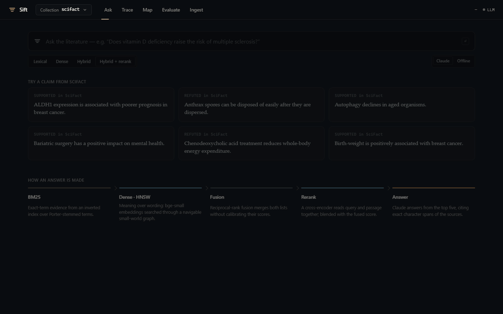

| | |
|---|---|
| 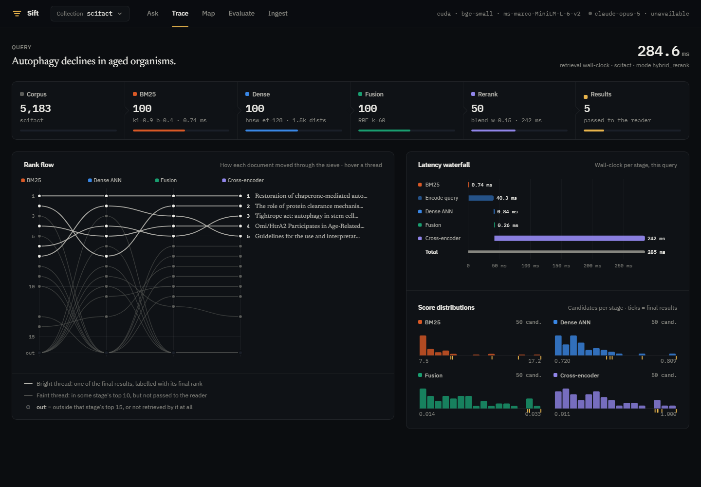 | 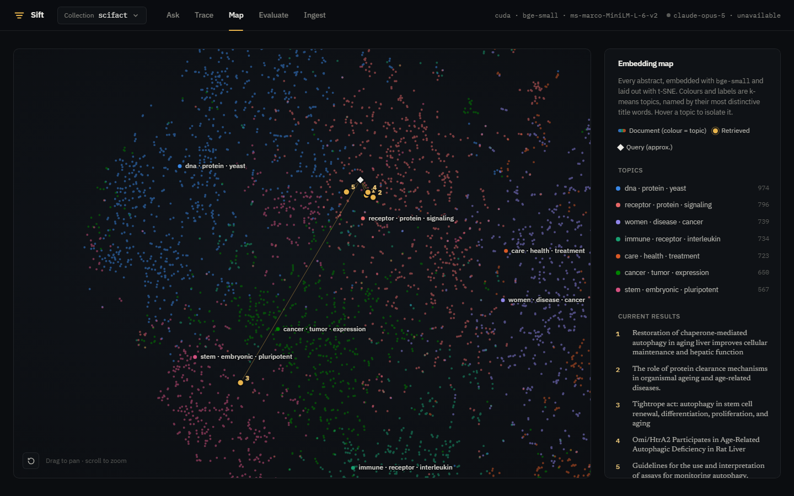 |
| **Trace.** The sieve for one query: candidates and latency per stage, a rank-flow chart of how each document moved, and score distributions with the final picks ticked. | **Map.** t-SNE of every abstract, coloured by k-means topic and labelled by c-TF-IDF. The query lands among its neighbours, and retrieved documents are numbered. |
| 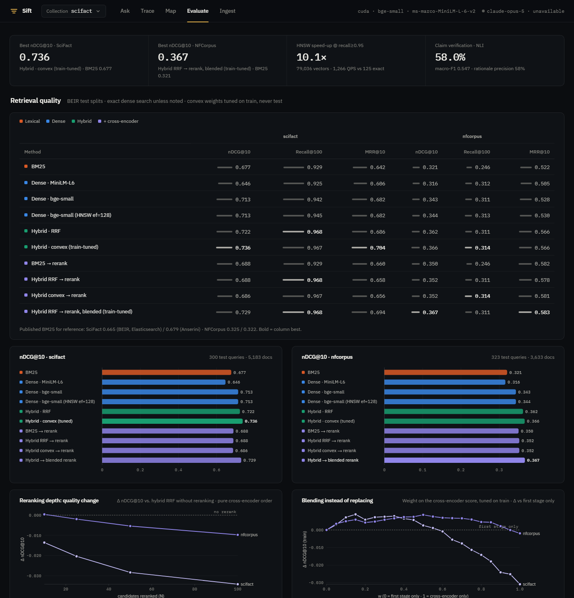 | 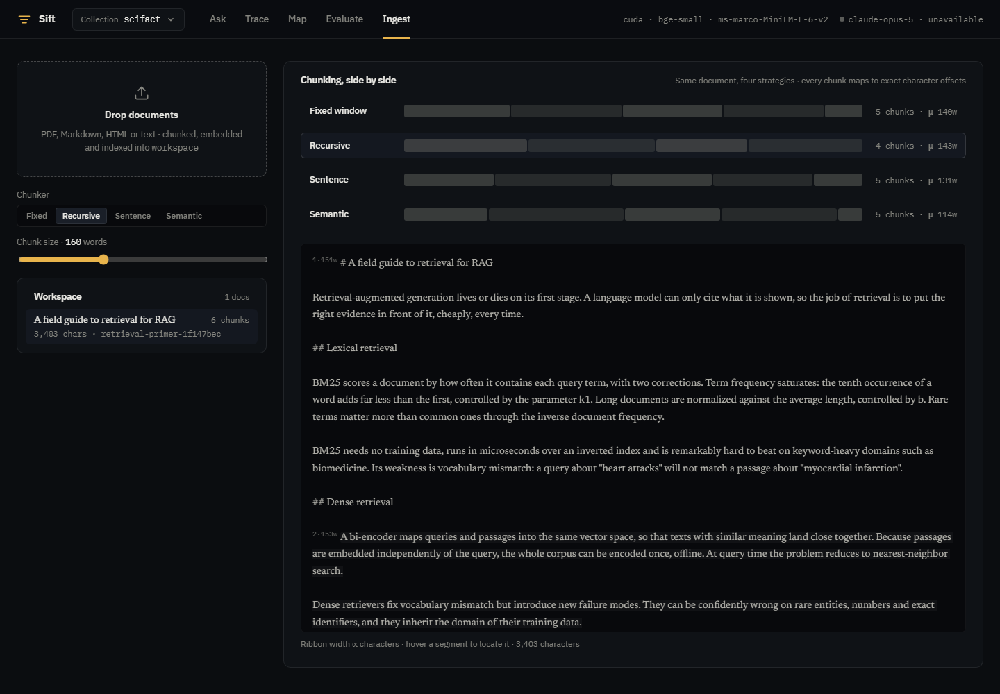 |
| **Evaluate.** The ablation table, rerank and fusion studies, a latency dot plot and HNSW Pareto curves, all rendered from `results/*.json`. | **Ingest.** Drop PDF/Markdown/HTML/text into a workspace collection and compare four chunkers on the same document, with exact boundaries. |

Full-length dashboard: [`docs/assets/ui-eval-full.png`](docs/assets/ui-eval-full.png) · landing
page: [`docs/assets/ui-landing.png`](docs/assets/ui-landing.png).

Design notes:
- Dark "lab bench at night" theme: graphite surfaces, warm-paper ink, and a highlighter amber
  reserved for evidence.
- The four pipeline stages carry four colored-pencil hues, validated for color-vision deficiency on
  the dark surface.
- Map topics get seven palette hues assigned so that *bordering* topics stay distinguishable.
  On a t-SNE map nearly every topic touches every other, so this can't be perfect: 86–87% of
  shared border length passes the normal-vision check and 92–95% the CVD floor (recorded in
  `projection.json`). Every topic is also labelled on the map and named in the hover tooltip.
- IBM Plex for UI and data, Newsreader for reading.
- Hand-written SVG and canvas charts: no framework and no build step.

---

## Quickstart

```bash
pip install -e ".[dev]"
python -m sift.datasets download   # SciFact, NFCorpus, SciFact claims (~8 MB)
python -m sift.eval projection     # builds collections (BM25 + bge-small + HNSW) and embedding maps
python -m sift.server              # http://127.0.0.1:8002
```

Open **Ingest** and drop in `examples/retrieval-primer.md` to try the workspace collection. Set
`ANTHROPIC_API_KEY` for Claude answers (default model `claude-opus-5`, override with
`SIFT_LLM_MODEL`). Without a valid key the service says so and answers in clearly labeled offline
extractive mode.

### Reproduce

```bash
python -m sift.eval retrieval      # BEIR ablation, latency profile           → results/retrieval.json
python -m sift.eval blend          # tune CE blend on train, report on test   → results/retrieval.json
python -m sift.eval hnsw           # HNSW recall/QPS on ~79k sentence vectors → results/hnsw.json
python -m sift.eval claims --verifier nli      # offline end-to-end eval      → results/claims_nli.json
python -m sift.eval claims --verifier claude   # same with Claude (needs a key; responses cached)
python -m sift.eval figures        # docs/assets/*.png
pytest && ruff check .
```

A `Dockerfile` and `docker-compose.yml` are included as a deployment recipe.

---

## Repository map

| Path | What it is |
|---|---|
| `sift/text.py` | NFKD normalization, Lucene stop set, **Porter stemmer from scratch**, sentence splitter with exact spans |
| `sift/index/bm25.py` | Okapi BM25 over a precomputed sparse weight matrix; `explain()` for per-term contributions |
| `sift/index/hnsw.py` | **HNSW in numba**: level sampling, greedy descent, ef-beam search, heuristic neighbor selection, save/load |
| `sift/index/flat.py` | Exact inner-product search (ground truth) |
| `sift/embed.py` | bi-encoder wrapper (fp16, query prefixes, on-disk embedding cache) and a hashing embedder for tests |
| `sift/fusion.py` | RRF and convex fusion with min-max / z-score normalization |
| `sift/rerank.py` | cross-encoder reranker (+ dependency-free stand-in) |
| `sift/pipeline.py` | `Retriever.search()`: timed stages, blended rerank, UI-ready trace |
| `sift/chunking.py` | fixed / recursive / sentence / semantic chunkers with exact offsets |
| `sift/ingest.py` | PDF / Markdown / HTML / text loaders → passages |
| `sift/generate.py` | Claude generator (citations, streaming, refusal + fallbacks, typed errors), extractive fallback, verdict parsing, response cache |
| `sift/verify.py` | offline NLI claim verifier with relevance gating and train-tuned thresholds |
| `sift/eval/` | metrics (nDCG/Recall/MRR/MAP), retrieval ablation, blend study, HNSW benchmark, claim verification, figures |
| `sift/server.py` | FastAPI: search, SSE ask, ingest, chunk preview, projections, results |
| `web/` | the UI: `app.js`, `charts.js` (SVG), `map.js` (canvas), `styles.css` |
| `scripts/record_tour.py` | records the UI tour GIF with headless Chrome over the DevTools protocol |
| `tests/` | 172 tests: CPU-only, no network, no API key |

---

## Design notes

**BM25.** For term *t* and document *d*:

`w(t,d) = idf(t) · tf·(k1+1) / (tf + k1·(1 − b + b·|d|/avgdl))`, with `idf = ln(1 + (N − df + 0.5)/(df + 0.5))`.

This factor doesn't depend on the query, so the whole index is one `terms × docs` CSR matrix `W`, and
a query is scored as `q_tf · W[q_terms]`. The analyzer mirrors Lucene's `EnglishAnalyzer` so the
numbers compare directly with Anserini/Elasticsearch.

**HNSW.** Each node draws a level `⌊−ln U · 1/ln M⌋`. Insertion and search descend greedily to the
target layer, then run a beam search of width `ef`. Neighbors are chosen with the paper's heuristic
(Algorithm 4), which keeps a candidate only if it is closer to the base node than to every
already-kept neighbor; this preserves bridges between clusters.

Implementation details:
- Layer 0 is a dense `(N, 2M)` int32 adjacency matrix.
- Upper layers use a compact slot table addressed by a per-node offset.
- Visited sets use a generation counter instead of clearing.
- Every hot loop is a `numba.njit` kernel.

Expected search cost is O(log N) distance evaluations. Measured: 752 → 1,647 for 16× more data.

**Fusion.**
- RRF: `Σ_r 1/(k + rank_r(d))`. It is rank-only, so BM25's unbounded scores and cosine's [−1, 1] never
  need calibrating.
- Convex: `α·norm(dense) + (1−α)·norm(bm25)`, with α and the normalization chosen on train. A document
  missing from one list gets that list's floor. A test caught a bug where a constant-score list put
  its floor equal to its only candidate.

**Blended rerank.** `w·minmax(CE) + (1−w)·minmax(fused)` over the rerank pool, with `w` tuned on
train queries per collection: `w=0` keeps the first-stage order, `w=1` is a pure cross-encoder.

**Grounded generation.** Each passage becomes a `document` content block with
`citations: {enabled: true}`. Claude returns text blocks carrying `char_location` citations
(`document_index`, `start_char_index`, `end_char_index`), and Sift maps them to
`passage.start + offset` in the source. The request:
- streams over SSE;
- opts into server-side fallbacks;
- checks `stop_reason == "refusal"` before reading content;
- maps `RateLimitError → APIStatusError → APIConnectionError` to user-visible events.

A startup probe hits the free Models API to verify credentials without spending tokens.

**Evaluation discipline.**
- nDCG uses linear gains as in trec_eval.
- Queries without relevant documents are skipped, and missing runs score zero.
- Every tuned knob (α, w, NLI thresholds) is fit on train and frozen.
- Cross-encoder scores are cached per (query, passage) so ablations share work.
- Claude responses are cached on disk by request hash, so reruns are free.

---

## Limitations and next steps

- **Domain-tuned reranker.** The MS MARCO cross-encoder is out of domain. Fine-tuning on SciFact's
  809 training claims, or using a biomedical cross-encoder, is the obvious next experiment.
- **Claude evaluation.** The harness supports it (`--verifier claude`), but the numbers in this README
  come from the offline verifier.
- **Long documents.** The chunkers are tested for exactness, but there's no long-document retrieval
  benchmark yet. Next: compare chunkers on a QA set with long sources.
- **Scale.** At 100M documents the components stay but their implementations change (sharding, PQ,
  disk-based ANN, a GPU reranker pool). See [docs/scaling.md](docs/scaling.md).
- **Latency numbers** were taken on a shared GPU. Re-measure on dedicated hardware before quoting SLOs.

## References

- Robertson & Zaragoza, *The Probabilistic Relevance Framework: BM25 and Beyond* (2009)
- Porter, *An algorithm for suffix stripping* (1980)
- Malkov & Yashunin, *Efficient and robust approximate nearest neighbor search using HNSW graphs* (2016)
- Cormack, Clarke & Buettcher, *Reciprocal Rank Fusion outperforms Condorcet and individual rank learning methods* (2009)
- Thakur et al., *BEIR: A Heterogeneous Benchmark for Zero-shot Evaluation of IR Models* (2021)
- Wadden et al., *Fact or Fiction: Verifying Scientific Claims* (SciFact, 2020)
- Xiao et al., *C-Pack: Packaged Resources To Advance General Chinese Embedding* (BGE, 2023)
- Nogueira & Cho, *Passage Re-ranking with BERT* (2019)
